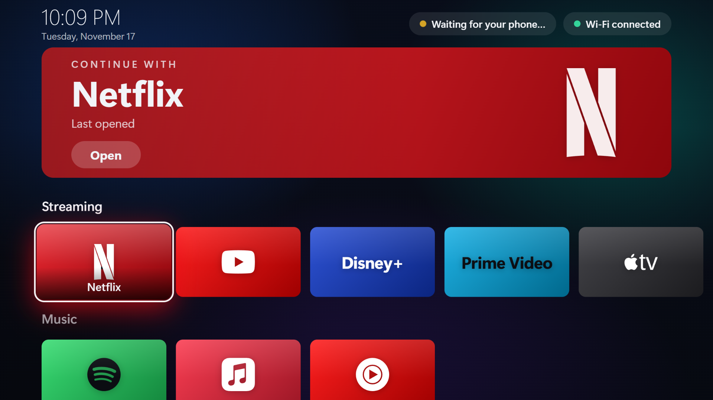
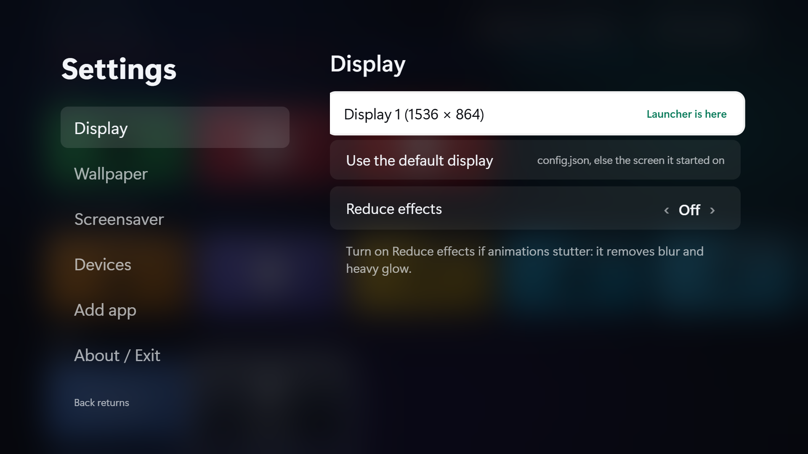
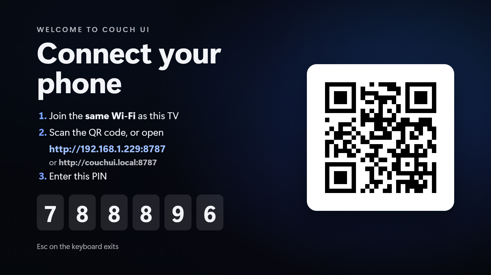

# Couch UI: setup guide

Couch UI is a fullscreen launcher you show on a TV (HDMI) and control from an iPhone over your home Wi-Fi.

**It only runs when you start it, and stops when you exit it.** There is no autostart, no login item, no scheduled
task, no background service, no tray icon and no watchdog. After you exit, nothing of it is left running.

Contents: [Build](#1-build-the-installer) · [Install](#2-install) · [Portable](#3-portable-exe) · [Run](#4-run-and-pair) ·
[Exit](#5-exit) · [Launcher, apps, wallpapers](#6-the-launcher-your-apps-wallpapers-and-screensaver) ·
[Config, data, logs](#7-config-data-and-logs) · [Fixed IP](#8-reserve-a-fixed-ip-in-your-router) ·
[Sleep](#9-keep-the-laptop-awake-while-it-runs) · [TV settings](#10-tv-settings) · [Troubleshooting](#11-troubleshooting)

---

## 1. Build the installer

Needs Windows 10/11 (x64), Node.js 20+ and an internet connection for the first build (electron-builder downloads its NSIS tools once).

```powershell
npm install
npm run dist
```

Output in `release\`:

| File | What it is |
| --- | --- |
| `Couch-UI-Setup-0.1.0.exe` | NSIS installer: Desktop + Start Menu shortcut "Couch UI", Windows Firewall rule |
| `Couch-UI-Portable-0.1.0.exe` | Single portable `.exe`, nothing is installed |

Other scripts: `npm run pack` builds just the unpacked app in `release\win-unpacked\` (fast, for testing),
`npm run icon` regenerates the placeholder icon in `build\`, `npm test` runs the unit tests.

The builds are **not code-signed**. The first time you run either file Windows SmartScreen may say
*"Windows protected your PC"*: click **More info → Run anyway**. That is expected for unsigned software.

## 2. Install

1. Double-click `Couch-UI-Setup-0.1.0.exe`.
2. Windows asks for **administrator permission once**, at install time only. This is what lets the installer add the
   firewall rule (below). Couch UI itself always runs as a normal user.
3. Pick the install folder (or keep the default) and finish. Shortcuts named **Couch UI** appear on the Desktop and
   in the Start Menu.

**Firewall rule.** The installer adds one inbound rule named `Couch UI`, for the installed program only, restricted to
**Private networks**. It covers the phone remote (TCP 8787) and the `couchui.local` name announcement (UDP 5353). The
uninstaller removes it. Nothing is opened on Public networks. To check it:

```powershell
netsh advfirewall firewall show rule name="Couch UI"
```

Your Wi-Fi must be set to the **Private** profile (Settings → Network & internet → Wi-Fi → your network →
*Network profile type: Private*). On a Public profile the rule does not apply and the phone will not connect.

**Uninstall:** Settings → Apps → Couch UI → Uninstall. This removes the app, shortcuts and firewall rule. It keeps
your data folder (see section 7) so a reinstall remembers your phones; delete that folder by hand to wipe everything.

## 3. Portable exe

Run `Couch-UI-Portable-0.1.0.exe` from anywhere. Nothing is installed and no firewall rule is created, so Windows shows
its normal *"Allow access"* prompt the first time: **tick Private networks only** and click Allow.

The portable build unpacks itself to a new temporary folder on every launch, so Windows may ask again each time. To avoid
that, add two port-based rules once (run PowerShell **as administrator**):

```powershell
netsh advfirewall firewall add rule name="Couch UI portable (remote)" dir=in action=allow protocol=TCP localport=8787 profile=private
netsh advfirewall firewall add rule name="Couch UI portable (mDNS)"   dir=in action=allow protocol=UDP localport=5353 profile=private
```

Remove them later with `netsh advfirewall firewall delete rule name="Couch UI portable (remote)"` (and the same for
`(mDNS)`). If you changed the port in `config.json`, use that port instead of 8787.

## 4. Run and pair

1. Connect the laptop to the TV by HDMI and make sure the TV shows the laptop's screen (Win+P → *Extend* or
   *Second screen only*; see section 10).
2. Double-click **Couch UI** on the Desktop. The launcher goes fullscreen.
3. On the very first run it shows a full-screen **Connect your phone** page with a QR code, the address and a PIN:
   - `http://192.168.x.x:8787`, the address that always works, and
   - `http://couchui.local:8787`, a name that keeps working if the laptop's IP changes.
4. On the iPhone (same Wi-Fi) scan the QR code or type either address in Safari, enter the PIN.
5. Optional: Safari → Share → **Add to Home Screen** for a full-screen remote.

The PIN and QR only show while pairing is open (first run, or for 2 minutes after you press **P** on the laptop, use
**Settings → Devices → Pair new device**, or tap *Pair new device* on an already-paired phone). Once a phone pairs they disappear, and that phone stays paired across
restarts. iOS may ask *"Allow … to find and connect to devices on your local network"*: allow it, it is needed for
`couchui.local`.

## 5. Exit

Any of these quits the app completely (stops the servers, frees the port, withdraws `couchui.local`, releases the
keep-awake request):

- Press **Esc** on the laptop keyboard while the launcher is in front, or
- On the phone: **Settings → Exit launcher**, then tap **Tap again to exit**.

To confirm nothing is left running, open Task Manager and look for **Couch UI** (or run
`tasklist /FI "IMAGENAME eq Couch UI.exe"`): after exit it lists nothing.

## 6. The launcher, your apps, wallpapers and screensaver



**Home.** Clock and date on the left; on the right the network status and a small phone indicator. Below is a hero
banner with the app you opened last (with an **Open** button; a welcome banner until you have opened something), then rows:
**Streaming**, **Music**, **Local & Media**, **Apps**. Use the arrow keys or the phone's D-pad: left/right move along a
row (it scrolls to follow), up/down change row, and **up from the first row** reaches the hero. **OK** opens, **Back/Home**
return to the first tile. The **Settings** tile is the last tile of the last row.

**Apps are defined in `apps.json`** (next to `config.json`; the installed app seeds `%APPDATA%\Couch UI\apps.json` on first
run and never overwrites your edits). Restart Couch UI after changing it.

```jsonc
{ "apps": [
  { "id": "netflix", "name": "Netflix", "category": "Streaming", "launch": "url",
    "target": "https://www.netflix.com", "color": "#E50914", "icon": "netflix" },
  { "id": "vlc", "name": "VLC", "category": "Local & Media", "launch": "exe",
    "target": "%ProgramFiles%\VideoLAN\VLC\vlc.exe", "color": "#FF8800", "icon": "vlcmediaplayer" },
  { "id": "music", "name": "Apple Music", "category": "Music", "launch": "store-app",
    "target": "AppleInc.AppleMusicWin_nzyj5cx40ttqa!App", "color": "#FA243C" }
] }
```

| Field | Meaning |
| --- | --- |
| `id` | Unique, lower-case letters/digits/`-`/`_`. |
| `name`, `category` | Shown on the tile / which row. `Streaming`, `Music`, `Local & Media`, `Apps` come first in that order; any other category becomes an extra row. |
| `launch` | `url` opens in your browser; `exe` starts a program (`%ProgramFiles%`-style variables work); `store-app` starts a Microsoft Store app by its AppUserModelID (find it with `Get-StartApps` in PowerShell) or a protocol such as `ms-windows-store:`. |
| `color` | Brand colour `#rrggbb`: the tile gradient. |
| `icon` | Optional [simple-icons](https://simpleicons.org) slug. The logos are bundled with the app; nothing is downloaded. |
| `image` | Optional file name in `assets\custom\` to use instead of the logo. |

**Logos.** Brands simple-icons does not carry (Disney+, Prime Video, Stan, Binge, Kayo, ABC iview, SBS On Demand, 9Now,
7plus, 10) get a generated bold name tile in the brand colour. To use a real logo instead, put an image in
`%APPDATA%\Couch UI\assets\custom\` named after the app id (`stan.png`, `stan.svg`, `.jpg`, `.webp`), or point `image` at
a file name. A wide logo with a transparent background works best.

**Missing apps.** If a program is not installed the tile shows **Not installed** (dimmed) and opening it shows a clear
message instead of failing. URL apps always open.

**Browser.** URL apps open in your default browser. To force one, set `"browser"` in `config.json` to `"chrome"`, `"edge"`,
`"firefox"`, `"brave"` or the full path of a browser `.exe`. If that browser is not installed, the default browser is used.

**Wallpapers.** Four generated gradients are built in. Put your own `jpg`, `png` or `webp` pictures in
`%APPDATA%\Couch UI\wallpapers\` (the folder is created for you; **Settings → Wallpaper → Open wallpapers folder** opens
it). Choose one picture, or *Rotate* every 1–30 minutes. Nothing is downloaded.

**Screensaver.** After 5 idle minutes (change or turn off in **Settings → Screensaver**) the launcher fades to a slow
slideshow of your wallpaper pictures (the built-in gradients if you have none) with a large clock. It only runs while
the launcher itself is showing, never while another app is in front. Any key, mouse movement or remote input wakes it,
and **that first input does nothing else**.



**Settings** (arrow keys; Back returns): **Display** (move the launcher to another screen; *Reduce effects*),
**Wallpaper**, **Screensaver**, **Devices** (paired phones, *Pair new device*, *Forget all devices*), **Add app** (coming in
M7) and **About / Exit**. *Reduce effects* removes blur, glow and the Ken Burns zoom: switch it on if animations stutter
on a slow GPU. The white focus ring is always drawn, whatever this setting.

**Phones.** Until a phone has been paired, the launcher shows a full-screen **Connect your phone** page (QR code, address
and PIN). Once phones are paired, there is no PIN or QR on the home screen, only a small *Waiting for your phone…* chip
while none is connected. **Settings → Devices → Pair new device** (or **P** on the keyboard) shows the QR page for 2 minutes.



## 7. Config, data and logs

Everything lives in `%APPDATA%\Couch UI\` (paste that into Explorer's address bar):

| Path | Purpose |
| --- | --- |
| `config.json` | **Your settings** (port, display, browser). Created on first run from the defaults; never overwritten by updates. |
| `apps.json` | **Your apps** (section 6). Same rules as `config.json`. |
| `wallpapers\` | Your wallpaper / screensaver pictures. |
| `assets\custom\` | Optional custom logo images for apps. |
| `devices.json` | Remembered phones (only hashes of their tokens, never the tokens). |
| `settings.json` | Choices made on the launcher: display, wallpaper, screensaver delay, reduce effects, last opened app. |
| `logs\couch-ui.log` | Log file. Rotates at 1 MB and keeps the last 5 files (`couch-ui.1.log` … `couch-ui.4.log`). |

Edit `config.json` with Notepad and restart Couch UI to apply:

```jsonc
{
  "port": 8787,          // phone remote port
  "display": "auto",     // "auto" = the screen it started on, "primary", a display id, or part of a monitor's name
  "browser": "default"   // "default", "chrome", "edge", "firefox", "brave" or the full path of a browser .exe
}
```

(The real file must be plain JSON: no comments. Remember to double the backslashes in Windows paths.)

Logs never contain the PIN or any token. If something misbehaves, the newest lines of `couch-ui.log` are the first
place to look.

## 8. Reserve a fixed IP in your router


`couchui.local` already survives IP changes, but a fixed address makes the plain IP URL and bookmarks reliable too.
This is called a **DHCP reservation** (or "static lease" / "address reservation").

1. Find the laptop's Wi-Fi MAC address: `ipconfig /all`, look at the **Wi-Fi** adapter's *Physical Address*.
2. **Important:** turn off Windows' random address for that network, otherwise the MAC changes and the reservation
   stops matching: Settings → Network & internet → Wi-Fi → *your network* → **Random hardware addresses: Off**,
   then reconnect to the Wi-Fi.
3. Open your router's admin page (often `192.168.1.1` or `192.168.0.1`), go to *LAN / DHCP / Address Reservation*.
4. Add an entry: laptop MAC → an address **outside** the router's normal DHCP pool (for example `192.168.1.50` if the
   pool is `.100`–`.200`), save, and reconnect the laptop to the Wi-Fi.
5. Check with `ipconfig`. The launcher shows the new address; re-scan the QR code once if the phone had the old one.

## 9. Keep the laptop awake while it runs

While the launcher runs it asks Windows to keep the **display** awake (a power request that is released on exit).
Windows can still sleep from the lid, the power button, or an explicit Sleep, so for a laptop that drives a TV also set:

- Settings → System → Power & battery → Screen and sleep → *When plugged in, put my device to sleep after* → **Never**.
- Close-lid behaviour: Control Panel → Power Options → *Choose what closing the lid does* → **When plugged in: Do
  nothing**. Needed if you want the lid shut while the TV is the only screen.

If the laptop does sleep and wakes later, Couch UI notices the resume, re-checks the network, re-binds its server if
needed, re-announces `couchui.local` and re-detects displays. The phone reconnects by itself within a few seconds.

## 10. TV settings

Wording differs per brand; look for these:

- **Just Scan / Screen Fit / Full Pixel / Dot by Dot / "Original"** for the aspect ratio. Without it the TV zooms
  and crops the picture (overscan), cutting off the tile edges and the PIN panel. This is the most important setting.
- **PC mode** for the HDMI input (on many TVs: rename the input to "PC", or pick the *PC* / *Game* picture mode). It
  gives sharp text (full 4:4:4 colour) and the lowest latency.
- **Turn off** motion smoothing / frame interpolation, noise reduction and dynamic contrast.
- **60 Hz:** Windows Settings → System → Display → *Advanced display* → choose **60 Hz** for the TV. At 4K, 60 Hz needs
  an HDMI 2.0 cable and port; if the picture flickers or drops out, use 1080p at 60 Hz or 4K at 30 Hz.
- **HDR off** (Windows Settings → System → Display → HDR) unless you want it for video, as it dims normal desktop colours.
- **Display scaling** 100 %–150 % so the launcher text is readable from the couch.
- **Win+P:** *Extend* keeps the laptop screen usable. Then use the phone's **Settings → Display** to put the launcher on
  the TV. *Second screen only* makes the TV the only screen (required if the lid is closed).

## 11. Troubleshooting

| Problem | What to try |
| --- | --- |
| Phone cannot open the page | Same Wi-Fi? Laptop network profile set to **Private**? Router "client/AP isolation" off? Firewall rule present (section 2)? Try the IP address instead of `couchui.local`. |
| `couchui.local` does not open but the IP does | Allow the iOS local-network prompt; some routers/VPNs block mDNS; use the IP address (give the laptop a fixed IP, section 8). |
| Red banner "Port 8787 is already in use" | Another program (or another copy of Couch UI) has the port. Close it, or change `"port"` in `config.json` and restart. |
| Launcher does not take keyboard focus after Home | Windows sometimes refuses; the launcher still appears and the phone still navigates it. See the log for which method worked. |
| Status line says *No network connection* | Wi-Fi dropped. The launcher recovers by itself when it returns; phones reconnect automatically. |
| Phone says "This phone isn't paired any more" | Pairing was reset ("Forget all devices"). Press **P** on the laptop and enter the new PIN. |
| Need to start over | Exit Couch UI, delete `%APPDATA%\Couch UI\`, start again. |
